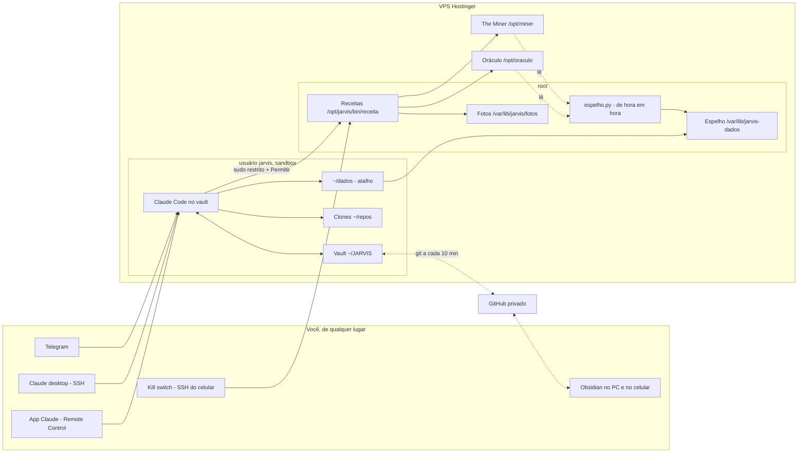

# Arquitetura

**Em uma frase:** o Obsidian é a memória, o Claude Code é o processador, receitas, scripts e MCP são as mãos, timers e canais são o sistema nervoso — e tudo mora no VPS. O Obsidian não "tem" IA: é a janela para os mesmos arquivos que o Claude lê e escreve.

## As quatro camadas
| Camada | O que é | Peças | Regra |
|---|---|---|---|
| Memória | Markdown no vault | pastas numeradas, índices, frontmatter, Bases | se não está no vault, o Jarvis não sabe |
| Motor | Claude Code na raiz do vault | `CLAUDE.md`, rules, skills, subagentes, hooks | comportamento vem de arquivo versionado |
| Mãos | o que age fora do vault | receitas (root), espelho, scripts, MCP | cada mão é superfície de ataque: só entra com uso semanal |
| Sistema nervoso | gatilhos | timers do systemd, Remote Control, Telegram | autonomia só onde o erro é barato e reversível |

## Três memórias — e qual manda
| Memória | Onde vive | Papel |
|---|---|---|
| Memória do claude.ai (app e Projetos) | nuvem da Anthropic | atalho para conversas fora do Jarvis; não é fonte da verdade |
| Auto memory do Claude Code | `~/.claude/projects/.../memory` | **desligada** (`autoMemoryEnabled: false`) |
| Vault | arquivos versionados | **fonte da verdade**: `50-jarvis/memoria.md` + notas de assunto |

## Memória sob demanda
Índice da raiz (`VAULT-INDEX.md`) → índice da pasta (nota com o nome da pasta) → nota-mestre → `grep`. Boot lê só o índice, a memória e as prioridades. Índice desatualizado é memória perdida: manter é regra.

## Por que Claude Code e não plugin de IA no Obsidian
Um motor só = um lugar para as regras, uma trilha de auditoria (git + log) e um custo (sua assinatura).
